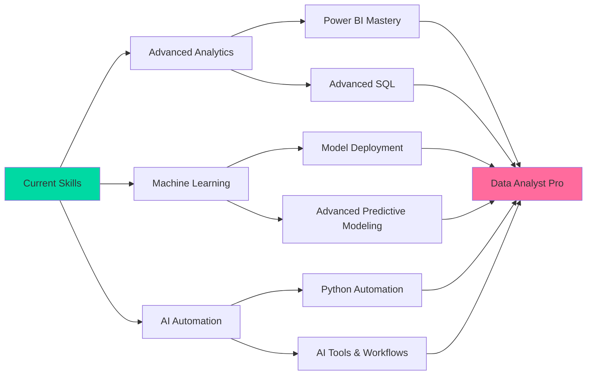

<div align="center">
  
</div>

<p align="center">
  
</p>

<p align="center">
  <a href="https://www.linkedin.com/in/harshita-singh-4044b52a5/">
    
  </a>
  <a href="mailto:harshitasingh1067@gmail.com">
    
  </a>
  <a href="https://github.com/Harshiitaaa10">
    
  </a>
</p>

<p align="center">
  
</p>


## 💫 **ABOUT ME**

<table>
<tr>
<td width="50%" valign="top">

### 🎯 **CURRENT MISSION**

```python
harshita = {
    "name": "Harshita Singh",
    "title": "Data Analyst Intern & Aspiring AI/ML Developer",
    "education": "B.Tech CSE (Data Science & AI), SRM University",
    "location": "New Delhi, India 🇮🇳",

    "working_on": [
        "Data analytics & reporting @ DevLabs Technology",
        "Predictive modeling & recommendation systems",
        "Power BI & Excel dashboards",
        "Python-based AI automation",
    ],

    "philosophy": """
    Clean the data first ✓
    Find the story in it ✓✓
    Build something people can use ✓✓✓
    """,

    "currently_exploring": {
        "data_analytics": ["EDA", "Power BI", "SQL optimisation"],
        "machine_learning": ["Predictive modelling", "Recommendation systems", "Regression & Classification"],
        "ai_automation": ["Python automation", "AI tools", "Workflow efficiency"],
    },
}

print("Turning raw data into decisions, one dashboard at a time 📊")
```

</td>
<td width="50%" valign="top">

### 💭 **PHILOSOPHY & APPROACH**

<br>

> **"I don't just want a chart that looks good—**  
> **I want it to answer the question**  
> **someone actually asked."**

<br>

**My Approach:**

🔍 **Clean First** → Messy data → Trustworthy data  
🧩 **Find the Signal** → Numbers → Insight  
⚡ **Build & Ship** → Analysis → Working dashboard  
🎯 **Keep Improving** → Good → Better → Production-ready  
📚 **Explain Simply** → Technical → Understandable  

<br>

**Impact Over Buzzwords**  
Dashboards and models that answer real questions, not just look impressive.

</td>
</tr>
</table>


## 🔭 **WHAT I'M UP TO**

<div align="center">
  <table>
    <tr>
      <td width="33%" align="center">
        <br>
        <h3>🔭 CURRENTLY BUILDING</h3>
        <p align="left">
        📊 Data analytics work @ DevLabs Technology<br>
        🏠 House Price Prediction: ML model<br>
        🎬 MovieHub: movie recommendation system<br>
        🚗 Car Price Prediction: predictive modeling
        </p>
      </td>
      <td width="33%" align="center">
        <br>
        <h3>🌱 CURRENTLY LEARNING</h3>
        <p align="left">
        📈 Advanced Power BI & dashboards<br>
        🤖 Machine Learning & Predictive Modeling<br>
        ⚙️ Python-based AI automation<br>
        🗄️ SQL optimisation
        </p>
      </td>
      <td width="33%" align="center">
        <br>
        <h3>🤝 OPEN TO</h3>
        <p align="left">
        📊 Data Analyst internships<br>
        🤖 ML / AI internships<br>
        ⚙️ AI automation projects<br>
        💡 Data science projects & collaboration
        </p>
      </td>
    </tr>
  </table>
</div>

<br>

| | |
|:---|:---|
| 👯 **Looking to collaborate on** | Predictive modeling, recommendation systems, data analytics dashboards and AI automation projects |
| 💬 **Ask me about** | Python, Pandas, Scikit-learn, Power BI, EDA, Flask, recommendation systems, data cleaning |
| ⚡ **Fun fact** | I secured International Rank 1 and a Gold Medal in the SOF Mathematics Olympiad (2022) 🥇 |


## 🚀 **FEATURED PROJECTS**

<div align="center">

| 🧩 **Project** | 📝 **What it does** | 🧰 **Tech** |
|:---|:---|:---|
| 🏠 **House Price Prediction** | ML model that predicts house prices from property features, with data cleaning, EDA and visualisation | Python, Pandas, NumPy, Matplotlib, Scikit-learn |
| 🎬 **MovieHub** | Content-based movie recommender using cosine similarity, with TMDb metadata and posters | Python, Flask, Scikit-learn, HTML, CSS, TMDb API |
| 🏛️ **Smart Civic Sense** | Civic issue reporting prototype with classification, urgency analysis, authority recommendations and automated complaint generation | HTML, CSS, JavaScript, localStorage, Vercel |
| 🚗 **Car Price Prediction** | Predictive modeling workflow that estimates car prices from vehicle attributes | Python, Pandas, Scikit-learn |
| 📊 **Data Analytics Dashboards** | Dashboards for student performance, Superstore sales (~10K records) and HR analytics to track KPIs and trends | Excel, Power BI, PivotTables |

</div>


## 🛠️ **TECH STACK**

<div align="center">

### **📊 DATA & ANALYTICS**

<table>
<tr>
<td align="center" width="20%">

<br><strong>Python</strong>
</td>
<td align="center" width="20%">

<br><strong>SQL</strong>
</td>
<td align="center" width="20%">

<br><strong>Pandas</strong>
</td>
<td align="center" width="20%">

<br><strong>NumPy</strong>
</td>
<td align="center" width="20%">

<br><strong>Matplotlib</strong>
</td>
</tr>
</table>


<br>

### **🤖 AI / ML**


<br>

### **⚡ BACKEND & APPS**

<table>
<tr>
<td align="center" width="25%">

<br><strong>Flask</strong>
</td>
<td align="center" width="25%">

<br><strong>JavaScript</strong>
</td>
<td align="center" width="25%">

<br><strong>HTML5</strong>
</td>
<td align="center" width="25%">

<br><strong>CSS3</strong>
</td>
</tr>
</table>

<br>

### **🎨 DEPLOYMENT & LANGUAGES**

<table>
<tr>
<td align="center" width="33%">

<br><strong>C</strong>
</td>
<td align="center" width="33%">

<br><strong>Vercel</strong>
</td>
<td align="center" width="33%">

<br><strong>Netlify</strong>
</td>
</tr>
</table>

<br>

### **🛠️ TOOLS**

<table>
<tr>
<td align="center" width="33%">

<br><strong>GitHub</strong>
</td>
<td align="center" width="33%">

<br><strong>VS Code</strong>
</td>
<td align="center" width="33%">

<br><strong>Jupyter</strong>
</td>
</tr>
</table>

</div>


## 🎯 **EXPERTISE MATRIX**

<div align="center">

| 🎯 **Domain** | 🔥 **Key Skills** |
|:---|:---|
| **Data Analytics** | Python (Pandas, NumPy) • SQL • Power BI • Excel • EDA • Data Cleaning |
| **Machine Learning** | Predictive modelling • Scikit-learn • Regression • Classification • Recommendation systems |
| **Visualization** | Matplotlib • Seaborn • Power BI • PivotTables |
| **Web & Apps** | Flask • HTML • CSS • JavaScript |
| **Deployment** | Vercel • Netlify |
| **Core CS** | C • Statistics |

</div>


## 🎓 **LEARNING ROADMAP**

<div align="center">



</div>


## 🏆 **ACHIEVEMENTS & EXPERIENCE**

<div align="center">

### 🥇 SOF Mathematics Olympiad (2022): International Rank 1 & Gold Medal

Secured International Rank 1 and a Gold Medal in the Science Olympiad Foundation (SOF) Mathematics Olympiad.

### 💼 Data Analyst Intern, DevLabs Technology, Noida

Sep 2026 – Present. Working on data analysis, cleaning, preprocessing and exploratory analysis to identify patterns and insights, and exploring Python-based AI automation to streamline repetitive tasks.

### 🔬 Data Analyst Intern, DRDO – DIPAS

Jun 2026 – Jul 2026. Cleaned and processed physiological datasets with active and passive experimental files, ran comparative calculations, and built a reusable Python/Pandas script to automate repetitive data-processing steps.

### 📜 Certifications

Python for Data Science (IBM Skills Network / SRM University) • Machine Learning with R (IBM Developer Skills Network / SRM University) • Web Development (Udemy)

</div>


## 📊 **GITHUB STATS**

<div align="center">


<br>


<br>

### 🏆 GitHub Trophies


</div>


## 💭 **PHILOSOPHY**

<div align="center">

### **"Good data analysis isn't about the fanciest model—**
### **it's about an answer someone can actually act on."**

<br>

**🎯 Core Principles:**

💎 **Clarity Over Complexity** • Simple, correct answers beat clever ones  
🔍 **Curiosity Driven** • Always asking what the data is really saying  
🚀 **Build to Ship** • Dashboards and apps people can actually use  
🤝 **Collaborate Actively** • Best insights come from asking the team

</div>


## 🤝 **LET'S CONNECT**

<div align="center">
<table>
  <tr>
    <td align="center" width="33%">
      <a href="https://www.linkedin.com/in/harshita-singh-4044b52a5/">
        
      </a>
      <br><sub>Professional Network</sub>
    </td>
    <td align="center" width="33%">
      <a href="mailto:harshitasingh1067@gmail.com">
        
      </a>
      <br><sub>Direct Message</sub>
    </td>
    <td align="center" width="33%">
      <a href="https://github.com/Harshiitaaa10">
        
      </a>
      <br><sub>Code Portfolio</sub>
    </td>
  </tr>
</table>

<br>

**⭐ Star my repositories if you find them helpful!**

</div>

<div align="center">
  
</div>

<div align="center">
  <sub>Made with 💜 by <a href="https://github.com/Harshiitaaa10">Harshita Singh</a> • Powered by curiosity, coffee, and clean data ☕✨</sub>
</div>
